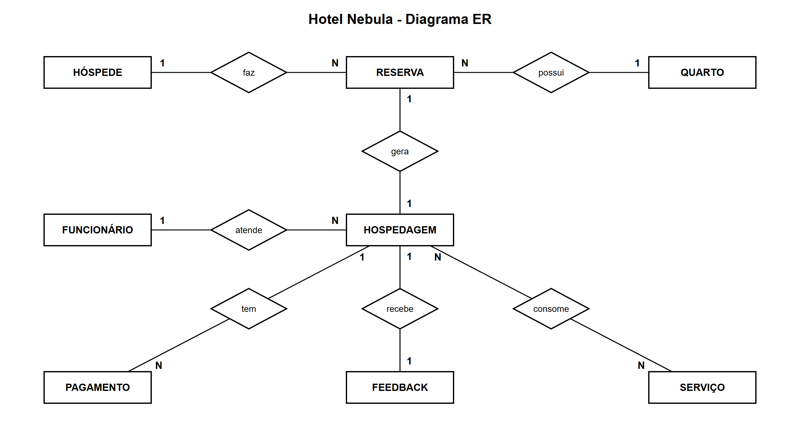

# Hotel Nebula 

A rede de Hotel Nebula está expandindo suas operações e precisa organizar digitalmente seus dados para melhorar reservas, hospedagens, serviços, avaliações de clientes e gestão dos quartos. A empresa quer desenvolver, no futuro, uma API de gestão hoteleira, mas antes disso precisa estruturar corretamente os dados.

### Objetivo geral

Desenvolver um projeto de banco de dados que percorra as etapas de:

- compreensão do problema
- modelagem dos dados
- implementação do banco
- extração e organização de dados

--- 

Crie um repositório no GitHub para o projeto e organize as entregas em três partes:

R: Arquivos do projeto:

- [modelo_logico.md](modelo_logico.md) - modelo lógico completo
- [diagrama_er.png](diagrama_er.png) - diagrama ER
- [1_criacao_banco.sql](1_criacao_banco.sql) - criação do banco e das tabelas
- [2_insercao_dados.sql](2_insercao_dados.sql) - dados para teste
- [3_consultas.sql](3_consultas.sql) - consultas

Rodar os 3 .sql nessa ordem (MySQL 8).

## Parte 1: Origem do Sistema

Em algum ponto entre a tecnologia, a organização e o caos elegante de um sistema mal planejado, existe o Hotel Nebula.

À primeira vista, ele parece apenas um hotel moderno: quartos confortáveis, reservas acontecendo a todo instante, hóspedes chegando de diferentes lugares, profissionais cuidando da operação, serviços extras sendo solicitados e avaliações aparecendo a cada nova estadia. Mas, por trás da recepção iluminada e das portas automáticas, existe um universo inteiro de dados tentando se organizar.

O problema é que esse universo ainda está disperso. O hotel tem informações sobre seus hóspedes, quartos, reservas, hospedagens, pagamentos, profissionais e avaliações, mas tudo isso está em sistemas diferentes, planilhas soltas ou até mesmo em papéis amassados. A equipe de gestão sabe que precisa colocar ordem nesse caos para melhorar a experiência dos clientes e otimizar a operação, mas não sabe por onde começar.

### Regras gerais do projeto

O sistema do hotel deve contemplar, no mínimo, elementos como:

- hóspedes
- quartos
- reservas
- hospedagens
- pagamentos
- profissionais/funcionários
- avaliações/comentários dos clientes

O que deve ser feito: 

- identificar as entidades principais do sistema
- identificar os relacionamentos entre elas
- levantar regras de negócio
- produzir o modelo conceitual
- transformar o modelo conceitual em um modelo lógico relacional

### Entregáveis:

- diagrama ER (Entidade-Relacionamento)
- descrição das entidades e relacionamentos

R:

### Entidades

- **hospedes**: quem se hospeda no hotel. Brasileiro com CPF, estrangeiro com passaporte.
- **quartos**: número, andar, tipo, capacidade, preço da diária e se está disponível ou em manutenção.
- **funcionarios**: recepcionistas, gerente, camareira, garçom, motorista etc.
- **reservas**: quem vai ficar, em qual quarto, quais datas e por qual preço. Pode ser cancelada.
- **hospedagens**: a estadia que aconteceu mesmo, com check-in e check-out real e quem atendeu.
- **servicos**: serviços extras (café no quarto, spa, transfer, observatório...).
- **hospedagem_servicos**: cada serviço consumido numa hospedagem.
- **pagamentos**: os pagamentos de cada hospedagem.
- **feedbacks**: avaliação do hóspede depois da estadia (notas de 1 a 5 e comentário).

Separei reserva de hospedagem porque reserva é o combinado e hospedagem é o que aconteceu. Reserva cancelada não vira hospedagem, e o horário do check-in real pode ser diferente.

### Relacionamentos

- hóspede faz reserva (1:N)
- quarto recebe reserva (1:N)
- funcionário registra reserva (0..1:N, reserva pelo site não tem funcionário)
- reserva gera hospedagem (1:0..1, cancelada e futura não geram)
- funcionário atende hospedagem (1:N)
- hospedagem gera pagamento (1:N, pode pagar em partes)
- hospedagem consome serviço (N:N, por isso a tabela hospedagem_servicos)
- funcionário presta serviço (0..1:N)
- hospedagem recebe feedback (1:0..1)

### Regras de negócio

1. Todo hóspede tem e-mail único e pelo menos um documento (CPF ou passaporte).
2. Check-out tem que ser depois do check-in.
3. Um quarto não pode ter duas reservas no mesmo período.
4. Quarto em manutenção não pode ser reservado.
5. O preço da diária fica salvo na reserva, porque o preço do quarto muda.
6. Reserva cancelada tem que ter a data do cancelamento.
7. Uma reserva gera no máximo uma hospedagem.
8. Hospedagem sem check-out = hóspede ainda está no hotel.
9. O preço do serviço também fica salvo no consumo.
10. Só cartão de crédito parcela (até 12x).
11. Só pagamento aprovado conta no faturamento.
12. Só avalia quem se hospedou, uma vez por estadia, nota de 1 a 5.
13. Não pode apagar hóspede, quarto ou funcionário que tem histórico.

### Diagrama ER



Os tipos e restrições de cada tabela estão no [modelo_logico.md](modelo_logico.md).

## Parte 2: Montagem do Núcleo

Foco: implementação física do banco relacional

Agora O profissional precisa construir a estrutura do banco de dados de forma funcional e consistente.

O que deve ser feito:
- criar o banco de dados
- criar as tabelas
- definir chaves primárias e estrangeiras
- aplicar restrições
- pensar em tipos de dados apropriados
- inserir dados iniciais para testes

Entregáveis: 
- script de criação do banco
- script de inserção de dados
- breve documentação explicando a estrutura criada

R: Scripts: [1_criacao_banco.sql](1_criacao_banco.sql) e [2_insercao_dados.sql](2_insercao_dados.sql)

### Estrutura

- Banco `hotel_nebula` com 9 tabelas, todas com PK `INT AUTO_INCREMENT`.
- 10 chaves estrangeiras. Usei `ON DELETE RESTRICT` pra não perder histórico, e `SET NULL` onde o funcionário é opcional.
- `UNIQUE` em e-mail, CPF, número do quarto e nome do serviço. Também em `hospedagens.id_reserva` (1 hospedagem por reserva) e `feedbacks.id_hospedagem` (1 avaliação por estadia).
- `CHECK` nas regras: check-out depois do check-in, notas de 1 a 5, valores positivos, status/tipo/método só com os valores permitidos, só crédito parcela, cancelada precisa de data.
- `DEFAULT` nos status iniciais, país Brasil e data de cadastro.
- Índice nas datas das reservas (busca de disponibilidade) e na data do pagamento (faturamento).

Tipos:
- `DECIMAL(10,2)` para dinheiro;
- `DATE` nas datas da reserva e `DATETIME` no check-in/check-out real, porque aí a hora importa;
- `TINYINT` nas notas;
- `VARCHAR` com `CHECK` no lugar de `ENUM`.

### Dados de teste

- 10 quartos (o 203 em manutenção)
- 8 funcionários
- 12 hóspedes (3 estrangeiros)
- 8 serviços
- 26 reservas de 2026: 17 concluídas, 4 canceladas, 4 confirmadas e 1 pendente
- 18 hospedagens (1 hóspede ainda no hotel)
- 40 consumos de serviço
- 20 pagamentos
- 15 feedbacks

Considerei hoje como 23/11/2026, então tem gente hospedada e reserva futura. O valor dos pagamentos eu calculei com um `INSERT ... SELECT` (diárias + serviços) pra conta bater.

### Testando as restrições

```sql
-- check-out antes do check-in -> ERROR 3819: Check constraint 'reservas_chk_1' is violated
INSERT INTO reservas (id_hospede, id_quarto, data_checkin, data_checkout, valor_diaria) VALUES (1, 1, '2026-12-10', '2026-12-08', 250);

-- nota 7 -> ERROR 3819: Check constraint 'feedbacks_chk_1' is violated
INSERT INTO feedbacks (id_hospedagem, data_feedback, nota_geral) VALUES (14, NOW(), 7);

-- duas hospedagens pra mesma reserva -> ERROR 1062: Duplicate entry '1' for key 'hospedagens.id_reserva'
INSERT INTO hospedagens (id_reserva, id_funcionario, checkin_real) VALUES (1, 1, NOW());

-- cancelar sem data -> ERROR 3819: Check constraint 'reservas_chk_6' is violated
UPDATE reservas SET status = 'CANCELADA' WHERE id_reserva = 23;

-- PIX parcelado -> ERROR 3819: Check constraint 'pagamentos_chk_4' is violated
INSERT INTO pagamentos (id_hospedagem, data_pagamento, valor, metodo, parcelas) VALUES (1, NOW(), 100, 'PIX', 3);

-- apagar hóspede com reserva -> ERROR 1451: Cannot delete or update a parent row
DELETE FROM hospedes WHERE id_hospede = 1;
```

## Parte 3: Radar de Comando

Foco: consultas SQL e extração de dados

O hotel agora quer enxergar melhor sua operação. O profissional deve produzir consultas que gerem informações relevantes para gestão.

O que deve ser feito

Criar consultas que respondam perguntas como:

- quais quartos estão disponíveis em determinado período?
- quais hóspedes mais realizaram reservas?
- qual foi o faturamento por mês?
- quais serviços extras são mais consumidos?
- quais quartos receberam melhores avaliações?
- quais reservas foram canceladas?
- quantas hospedagens cada profissional atendeu?

R: As consultas estão no [3_consultas.sql](3_consultas.sql)

**1.** Quais quartos estão disponíveis em determinado período?

R: De 20/12 a 27/12/2026: 101, 102, 201, 202, 302 e 303. O 203 está em manutenção, e o 103, o 301 e o 401 já têm reserva.

O quarto está ocupado se tem reserva não cancelada que começa antes do fim do período e termina depois do início.

```sql
SET @inicio = '2026-12-20';
SET @fim    = '2026-12-27';

SELECT q.numero, q.tipo, q.capacidade, q.preco_diaria
FROM quartos q
WHERE q.status = 'DISPONIVEL'
  AND NOT EXISTS (
      SELECT 1
      FROM reservas r
      WHERE r.id_quarto = q.id_quarto
        AND r.status <> 'CANCELADA'
        AND r.data_checkin < @fim
        AND r.data_checkout > @inicio
  )
ORDER BY q.numero;
```

**2.** Quais hóspedes mais realizaram reservas?

R: Ana Beatriz Souza (4), Carlos Mendes (3), Fernanda Lopes (3, com 1 cancelada), Ricardo Almeida (2) e Mariana Ribeiro (2)

```sql
SELECT h.nome,
       COUNT(r.id_reserva) AS total_reservas,
       SUM(r.status = 'CONCLUIDA') AS concluidas,
       SUM(r.status = 'CANCELADA') AS canceladas
FROM hospedes h
JOIN reservas r ON r.id_hospede = h.id_hospede
GROUP BY h.id_hospede, h.nome
ORDER BY total_reservas DESC, concluidas DESC
LIMIT 5;
```

**3.** Qual foi o faturamento por mês?

R:
```
2026-01   3880.00
2026-02   3250.00
2026-03   7910.00
2026-04   5420.00
2026-05   5240.00
2026-06   1935.00
2026-07   7384.00
2026-08   4204.00
2026-10   2288.00
2026-11    760.00
```
Março e julho foram os melhores meses. Setembro não tem porque a única reserva foi cancelada. Considerei só pagamento aprovado.

```sql
SELECT DATE_FORMAT(data_pagamento, '%Y-%m') AS mes,
       COUNT(*) AS pagamentos,
       SUM(valor) AS faturamento
FROM pagamentos
WHERE status = 'APROVADO'
GROUP BY mes
ORDER BY mes;
```

**4.** Quais serviços extras são mais consumidos?

R: Café da manhã no quarto (42), Frigobar (18) e Lavanderia (17). Mas o que mais deu dinheiro foi a Noite no observatório (3000.00).

```sql
SELECT s.nome, s.categoria,
       SUM(hs.quantidade) AS quantidade_consumida,
       COUNT(DISTINCT hs.id_hospedagem) AS hospedagens_que_usaram,
       SUM(hs.quantidade * hs.preco_unitario) AS receita
FROM servicos s
LEFT JOIN hospedagem_servicos hs ON hs.id_servico = s.id_servico
GROUP BY s.id_servico, s.nome, s.categoria
ORDER BY quantidade_consumida DESC;
```

**5.** Quais quartos receberam melhores avaliações?

R: Suíte 301, média 5 em 2 avaliações. O 201 e o 303 também têm 5, mas com só 1 avaliação cada. O pior foi o 102 (nota 2).

```sql
SELECT q.numero, q.tipo,
       COUNT(f.id_feedback) AS avaliacoes,
       ROUND(AVG(f.nota_geral), 2) AS media_geral,
       ROUND(AVG(f.nota_limpeza), 2) AS media_limpeza,
       ROUND(AVG(f.nota_atendimento), 2) AS media_atendimento
FROM feedbacks f
JOIN hospedagens h ON h.id_hospedagem = f.id_hospedagem
JOIN reservas r ON r.id_reserva = h.id_reserva
JOIN quartos q ON q.id_quarto = r.id_quarto
GROUP BY q.id_quarto, q.numero, q.tipo
ORDER BY media_geral DESC, avaliacoes DESC;
```

**6.** Quais reservas foram canceladas?

R: 4 reservas: 6 (Juliana Castro, mudança de planos), 10 (Fernanda Lopes, voo cancelado), 14 (Larissa Nogueira, problema de saúde) e 19 (John Carter, encontrou preço melhor). Deu 4990.00 de receita perdida, e só a do John (suíte 401) foi 2850.00.

```sql
SELECT r.id_reserva, h.nome AS hospede, q.numero AS quarto,
       r.data_checkin, r.data_checkout,
       r.data_cancelamento, r.motivo_cancelamento,
       DATEDIFF(r.data_checkin, r.data_cancelamento) AS dias_de_antecedencia,
       DATEDIFF(r.data_checkout, r.data_checkin) * r.valor_diaria AS receita_perdida
FROM reservas r
JOIN hospedes h ON h.id_hospede = r.id_hospede
JOIN quartos q ON q.id_quarto = r.id_quarto
WHERE r.status = 'CANCELADA'
ORDER BY r.data_cancelamento;
```

**7.** Quantas hospedagens cada profissional atendeu?

R: Lúcia Andrade 7, Rafael Moreira 6, Bruno Tavares 3 e Helena Duarte 2. Os outros funcionários não fazem check-in.

```sql
SELECT f.nome, f.cargo, COUNT(h.id_hospedagem) AS hospedagens_atendidas
FROM funcionarios f
LEFT JOIN hospedagens h ON h.id_funcionario = f.id_funcionario
GROUP BY f.id_funcionario, f.nome, f.cargo
ORDER BY hospedagens_atendidas DESC;
```

### Extras

**8.** Taxa de ocupação por mês

R: Ficou entre 0% e 3,3%, porque tem poucos dados de teste.

```sql
WITH RECURSIVE dias AS (
  SELECT DATE('2026-01-01') AS dia
  UNION ALL
  SELECT dia + INTERVAL 1 DAY FROM dias WHERE dia < '2026-11-30'
)
SELECT DATE_FORMAT(d.dia, '%Y-%m') AS mes,
       COUNT(r.id_reserva) AS noites_ocupadas,
       ROUND(COUNT(r.id_reserva) / (COUNT(DISTINCT d.dia) * (SELECT COUNT(*) FROM quartos WHERE status = 'DISPONIVEL')) * 100, 1) AS ocupacao_pct
FROM dias d
LEFT JOIN reservas r
       ON r.status IN ('CONCLUIDA', 'CONFIRMADA')
      AND d.dia >= r.data_checkin AND d.dia < r.data_checkout
GROUP BY mes
ORDER BY mes;
```

**9.** Quem está hospedado agora?

R: Juliana Castro, quarto 201, sai dia 25/11

```sql
SELECT ho.nome, q.numero, h.checkin_real, r.data_checkout AS saida_prevista
FROM hospedagens h
JOIN reservas r ON r.id_reserva = h.id_reserva
JOIN hospedes ho ON ho.id_hospede = r.id_hospede
JOIN quartos q ON q.id_quarto = r.id_quarto
WHERE h.checkout_real IS NULL;
```

**10.** Conta de cada estadia

R: As encerradas estão todas pagas. A da Juliana dá 1580.00 e ela pagou 760.00 de sinal. A maior conta foi a do Ricardo Almeida: 6804.00 (7 noites na suíte 302).

```sql
SELECT h.id_hospedagem, ho.nome, q.numero,
       DATEDIFF(r.data_checkout, r.data_checkin) * r.valor_diaria AS diarias,
       COALESCE((SELECT SUM(hs.quantidade * hs.preco_unitario) FROM hospedagem_servicos hs WHERE hs.id_hospedagem = h.id_hospedagem), 0) AS servicos,
       COALESCE((SELECT SUM(p.valor) FROM pagamentos p WHERE p.id_hospedagem = h.id_hospedagem AND p.status = 'APROVADO'), 0) AS pago
FROM hospedagens h
JOIN reservas r ON r.id_reserva = h.id_reserva
JOIN hospedes ho ON ho.id_hospede = r.id_hospede
JOIN quartos q ON q.id_quarto = r.id_quarto
ORDER BY h.id_hospedagem;
```
